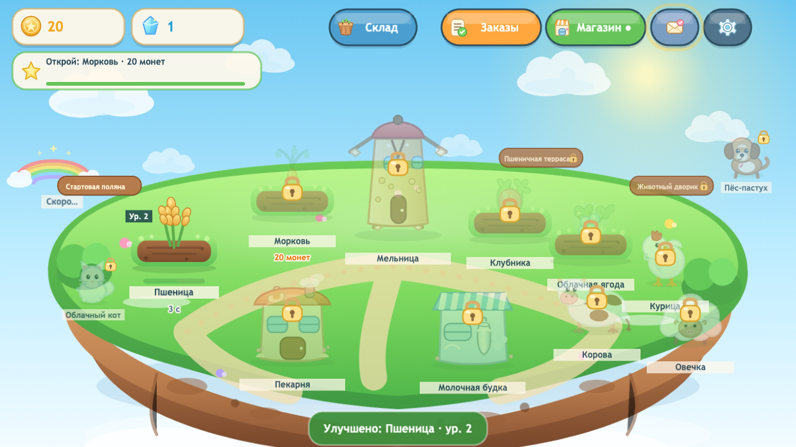

# Ферма на Облаке · Cloud Farm

Уютная idle-ферма на парящем острове для Playgama, Yandex Games и обычного web. Игрок собирает урожай, выполняет заказы, открывает животных и производственные здания, нанимает помощников и получает оффлайн-доход.



## Стек

- Phaser 3.90 + TypeScript 5.9 + Vite 7
- Vitest 3 для unit-тестов
- Canvas-based UI внутри Phaser, без DOM-интерфейса
- SVG-ассеты в `public/assets/images`
- Playgama Bridge JS Core (`bridge.initialize()`)
- Yandex Games SDK (`YaGames.init()`) для прямой публикации в Yandex
- MockAdapter для локальной разработки

Node.js 20+ (проверено на Node 24).

## Быстрый старт

```bash
npm install
npm run dev
```

Откройте адрес Vite. Локально автоматически используется MockAdapter: сохранение идёт в `localStorage`, rewarded/interstitial имитируются тёмным оверлеем.

Полезные команды:

```bash
npm run typecheck   # tsc --noEmit
npm test            # unit-тесты сервисов
npm run build       # production-сборка в dist/
npm run preview     # локальный предпросмотр собранной игры
```

Проверка платформенных режимов:

- `?platform=mock` — принудительный MockAdapter;
- `?platform=playgama` — Playgama Bridge даже в mock-окружении;
- `?platform=yandex` — YandexAdapter (локально `/sdk.js` обычно недоступен и произойдёт fallback на Mock).

## Управление

- Tap/click по грядке: собрать готовый урожай или посадить заново.
- Tap/click по животному: собрать продукт; во время цикла открывается панель объекта.
- Tap/click по зданию: открыть панель производства, собрать готовый товар.
- Верхняя панель: склад, заказы, магазин, настройки.
- В магазине открываются зоны, объекты и помощники.
- Награды за рекламу запускаются только по кнопке игрока.

Игра рассчитана на горизонтальную ориентацию. В портретном режиме на телефоне показывается подсказка «Поверните устройство».

## Что реализовано в MVP

- Один остров, 4 зоны: стартовая поляна, пшеничная терраса, животный дворик, мельничная платформа.
- 4 культуры, 3 животных, 3 здания, 12+ шаблонов заказов, 2 помощника.
- Посадка/рост/сбор, животные с цикличным производством, здания с рецептами.
- Апгрейды до 5 уровня с экспоненциальной ценой.
- Заказы с таймерами, наградами и автоматическим обновлением.
- Облачный кот: автосбор и пересадка пшеницы. Пёс-пастух: ускорение животных на 20%.
- Оффлайн-доход до 2 часов; не больше 60 циклов на объект, чтобы не ломать баланс.
- Rewarded-реклама: x2 оффлайн-доход и ускорение производства.
- Interstitial: только после 3 минут сессии, в естественных паузах (открытие зоны/каждая 5-я выполненная цель заказов). Частоту дополнительно контролирует платформа.
- Сохранение с версией, нормализацией и миграцией неполных данных; autosave каждые 20 секунд и после значимых действий.
- Локализация ru/en, выбор языка в настройках, язык платформы как источник по умолчанию.
- Pause/audio события платформы, пауза звука на рекламе.
- Синтезированные WebAudio-звуки и фоновая музыка без внешних аудиофайлов.
- Тесты сервисов и сборка, проверенные в Chrome headless на desktop и mobile landscape.

## Архитектура

```text
src/
  main.ts                     # boot: платформа, сохранение, GameContext, Phaser
  game/
    config.ts                 # конфиг Phaser
    data/                     # JSON-конфиги и загрузчик
    scenes/
      BootScene.ts
      PreloadScene.ts         # загрузка SVG, progress, переход в игру
      FarmScene.ts            # остров, объекты, зоны, помощники, ввод
      UIScene.ts              # HUD, туториал, все модальные панели
    systems/
      EventBus.ts
      TimeService.ts
      EconomyService.ts
      ProductionService.ts
      UpgradeService.ts
      UnlockService.ts
      OrderService.ts
      OfflineProgressService.ts
      TutorialService.ts
      SaveService.ts          # SaveService + SaveScheduler
      LocalizationService.ts
      AudioService.ts
      AdManager.ts
      GameContext.ts          # composition root игровых сервисов
    platform/
      MockAdapter.ts
      PlaygamaAdapter.ts
      YandexAdapter.ts
      createPlatform.ts       # auto-detect + fallback
    types/PlatformTypes.ts    # PlatformAdapter interface
    types/
    ui/                       # Button, Modal, theme, floating text
    views/FarmObjectView.ts
  data/                       # crops/animals/buildings/zones/orders/helpers/tutorial
  styles.css
tests/                        # Vitest unit-тесты
public/
  assets/images/              # SVG-ассеты
  playgama-bridge-config.json
scripts/                      # image/audio pipelines
docs/                         # спека, план, ассеты, платформа, публикация
```

Принципы:

- JSON-конфиги определяют экономику, цены, таймеры и контент.
- `GameState` — единственный источник прогресса.
- Сцены Phaser не меняют состояние напрямую, а вызывают методы сервисов.
- SDK скрыт за `PlatformAdapter`; игровые сервисы не знают о платформе.
- Время хранится timestamp-ами, поэтому пауза и оффлайн не ломают циклы.

## Экономика и данные

- Культуры: `src/data/crops.json`
- Животные: `src/data/animals.json`
- Здания и рецепты: `src/data/buildings.json`
- Зоны: `src/data/zones.json`
- Заказы: `src/data/orders.json`
- Помощники: `src/data/helpers.json`
- Туториал: `src/data/tutorial.json`
- Тексты: `src/data/locales/ru.json`, `src/data/locales/en.json`

Стартовый баланс: первая пшеница готова сразу, первый заказ — 2 пшеницы за 20 монет, первая грядка улучшается за 20 монет, курятник стоит 100 монет. Это даёт законченный первый цикл без тупика.

## Сохранения

- Ключ: `cloud_farm_save`
- Версия: `1`
- Формат: JSON `GameState`
- Autosave: каждые 20 секунд, с debounce 250 мс после значимых действий, на `pagehide`/`visibilitychange`.
- Повреждённое сохранение или версия из будущего игнорируются, игра стартует безопасно.
- Для Playgama используется `bridge.storage`, для Yandex — `ysdk.getStorage()`, для Mock — `localStorage`.
- Ошибка чтения сохранения не считается «новым игроком»: boot показывает безопасный экран ошибки, чтобы не перезаписать реальный прогресс.
- Оффлайн-доход считается от `lastSaveTimestamp`, максимум 2 часа, не более 60 циклов на объект.
- Невостребованный оффлайн-отчёт хранится в сохранении (`pendingOffline`) и переживает autosave/reload; claim сохраняется атомарно, при ошибке записи награда откатывается и остаётся в модалке.

## Тесты

```bash
npm test
```

Покрыто:

- инициализация и нормализация состояния;
- экономика, события, время;
- грядки, животные, здания, помощники, апгрейды;
- заказы и их доступность;
- оффлайн-доход, cap и x2;
- туториал и его награды;
- сохранение/загрузка/повреждённые данные;
- локализация;
- MockAdapter и auto-fallback платформы;
- AdManager (rewarded/interstitial, отмена, 3-минутный порог);
- GameContext (оффлайн, язык, audio state).

## Сборка и публикация

```bash
npm run build
```

Результат — `dist/`. Для Playgama загрузите содержимое `dist` как HTML5-билд; `playgama-bridge-config.json` уже лежит в корне билда. Для прямой публикации в Yandex разместите билд на домене, где доступен `/sdk.js`, либо публикуйте через Playgama Bridge и не подключайте нативный Yandex SDK.

Подробности:

- [Интеграция платформ](docs/PLATFORM_INTEGRATION.md)
- [Checklist публикации](docs/PUBLISHING_CHECKLIST.md)
- [Ассеты](docs/ASSETS.md)
- [Промпты Nano Banana](docs/NANO_BANANA_PROMPTS.md)
- [Дизайн](docs/superpowers/specs/2026-11-19-cloud-farm-design.md)
- [План реализации](docs/superpowers/plans/2026-11-19-cloud-farm-mvp.md)

## Ограничения MVP

- Нет второго острова, prestige, IAP, лидербордов и мультиплеера.
- Финальный арт и музыка — заменяемые ассеты; сейчас используются собственные SVG и синтезированные звуки.
- Портретная ориентация не адаптирована под полноценный UI; показывается подсказка повернуть устройство.
- Аналитические события платформы не отправляются отдельным слоем; минимальная статистика хранится в `GameStats`.
